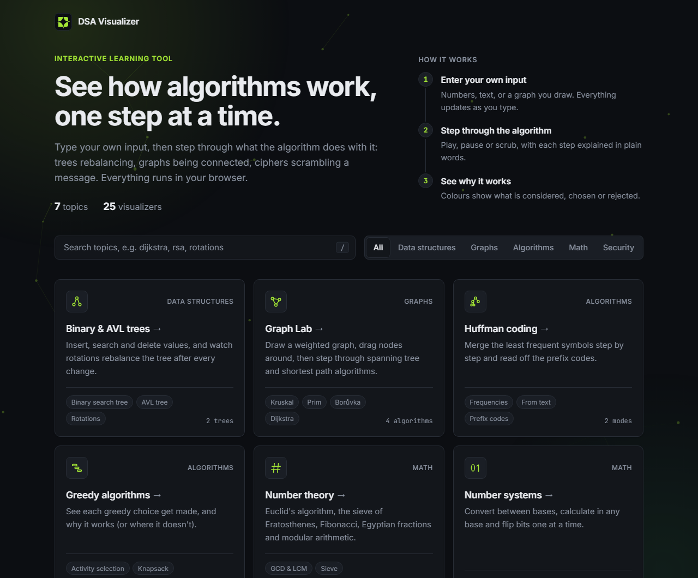
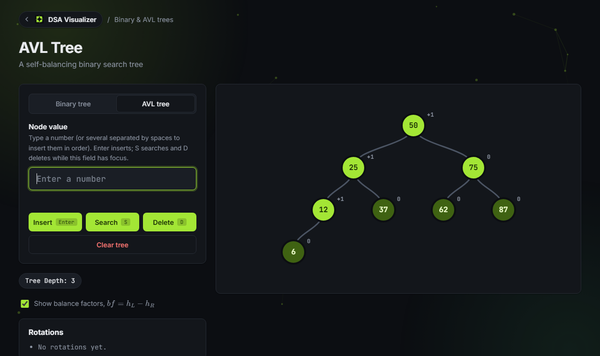
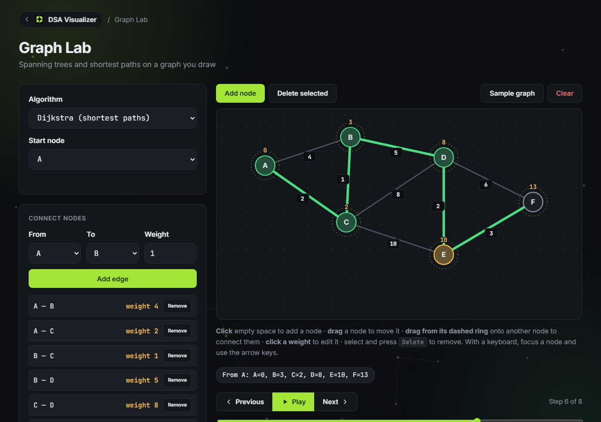
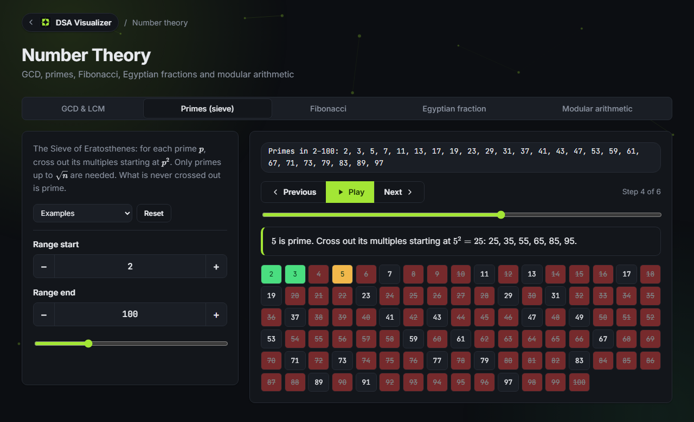
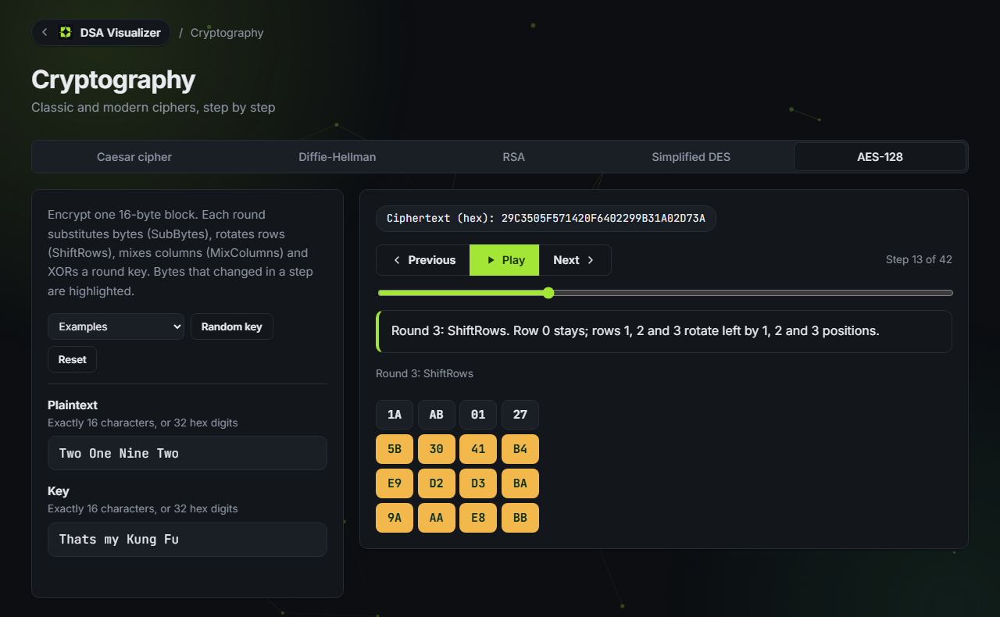
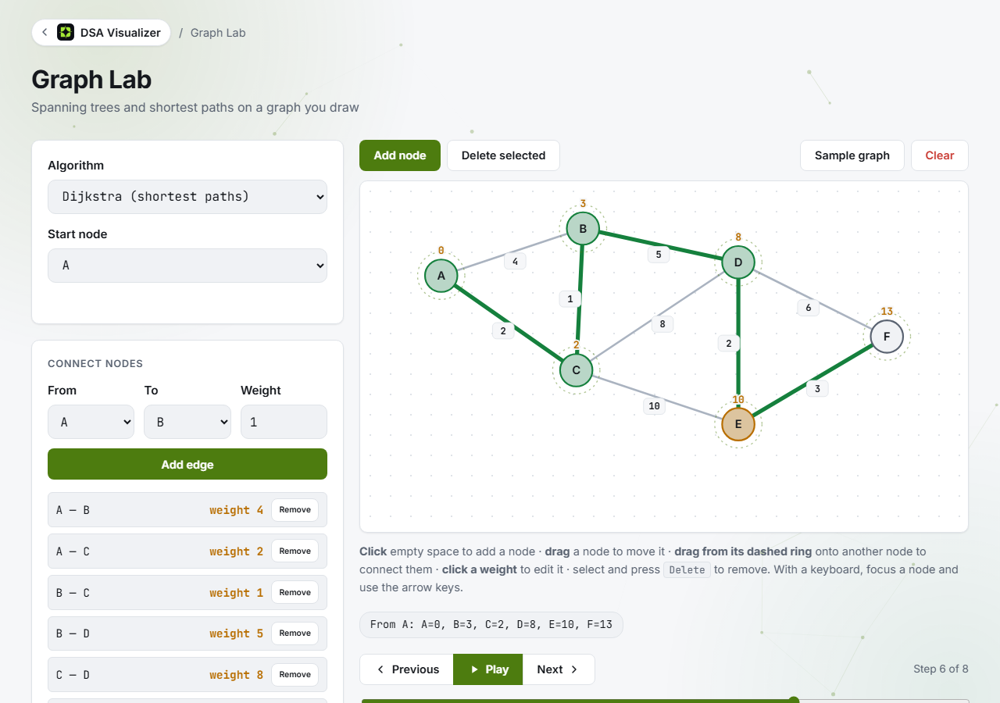

<div align="center">


# DSA Visualizer

**See how algorithms work, one step at a time.**

Interactive, step-by-step visualizers for data structures and algorithms: trees, graphs, greedy
algorithms, number theory and cryptography. Type your own input and watch what happens, all in the browser.

<sub>A compilation of three earlier projects, now in one place.</sub>

<br />


[](https://maxxqcty.github.io/dsa-visualizers/)

[**Live demo**](https://maxxqcty.github.io/dsa-visualizers/) &nbsp;·&nbsp; [Features](#features) &nbsp;·&nbsp; [Visualizers](#visualizers) &nbsp;·&nbsp; [Screenshots](#screenshots) &nbsp;·&nbsp; [Origins](#origins) &nbsp;·&nbsp; [Getting started](#getting-started) &nbsp;·&nbsp; [Contributing an algorithm](#adding-an-algorithm)

</div>

<br />

<p align="center">
  
</p>

> [!NOTE]
> **This repository is a compilation of three earlier projects** that each lived in their own repository. They have been
> merged, restyled and rebuilt here as one app with a shared design, input widgets and step player.
> See [Origins](#origins) for the original repositories.

## Features

- **Learn by doing.** Every visualizer takes your own input and updates as you type. There is no Run button.
- **Step through it.** Play, pause, scrub or step one move at a time. Each step is explained in plain words, with colour showing what is considered, chosen or rejected.
- **Real input widgets.** Number steppers with sliders, chip lists, editable tables, clickable bit toggles and an expression keypad, plus an Examples menu and Randomize on every lab.
- **Typeset maths.** Formulas such as $c = m^{e} \bmod n$ are rendered with KaTeX, so the explanations read like a textbook.
- **A graph you can drag.** Draw a weighted graph, move nodes, connect them from their rings, edit weights inline, then run Kruskal, Prim, Borůvka or Dijkstra on it.
- **Animated trees.** Binary and AVL trees slide into place as nodes are inserted and deleted, so rotations are easy to see.
- **Accessible by design.** Keyboard-friendly, labelled controls, live announcements, visible focus, and respect for `prefers-reduced-motion`.
- **Light and dark.** Follows your system theme.
- **Nothing to install.** Plain HTML, CSS and JavaScript. Open a file and it works.

## Visualizers

| Topic | What you can explore |
| --- | --- |
| **[Binary & AVL trees](trees/)** | Insert, search and delete; balance factors and a rotation log |
| **[Graph Lab](mst/)** | Kruskal, Prim, Borůvka (spanning trees) and Dijkstra (shortest paths) on a graph you draw |
| **[Huffman coding](huffman/)** | Build the tree merge by merge from frequencies or free text, then read off the prefix codes |
| **[Greedy algorithms](greedy/)** | Activity selection, fractional knapsack, coin change, job sequencing, mice to holes |
| **[Number theory](number-theory/)** | GCD and LCM, sieve of Eratosthenes, Fibonacci, Egyptian fractions, modular arithmetic |
| **[Number systems](number-systems/)** | Base conversion with working shown, a calculator in any base, bitwise operations |
| **[Cryptography](cryptography/)** | Caesar cipher, Diffie-Hellman, RSA, Simplified DES and AES-128, round by round |

## Screenshots

<table>
  <tr>
    <td width="50%"><br /><sub><b>AVL trees</b>: nodes rebalance with animated rotations</sub></td>
    <td width="50%"><br /><sub><b>Graph Lab</b>: draw, drag and run algorithms on your own graph</sub></td>
  </tr>
  <tr>
    <td width="50%"><br /><sub><b>Number theory</b>: the sieve of Eratosthenes, one prime at a time</sub></td>
    <td width="50%"><br /><sub><b>Cryptography</b>: AES-128 with every round shown</sub></td>
  </tr>
</table>

<p align="center">
  <br />
  <sub>The same interface in light mode</sub>
</p>

## Getting started

There is no build step and nothing to install.

```bash
git clone <this-repo-url>
cd binary-tree
```

You can also try it right away at **<https://maxxqcty.github.io/dsa-visualizers/>**. To run it locally, either open `index.html` in a browser, or serve the folder for a more realistic setup:

```bash
python -m http.server 8000
# or: npx serve
```

and visit <http://localhost:8000>. D3 and KaTeX are vendored in `vendor/`, so it works offline. The only
external request is for the Inter and JetBrains Mono web fonts, and the page falls back to system fonts without them.

## Project structure

<details>
<summary>Show the folder layout</summary>

```text
index.html              Home page: topic grid, search and category filters
trees/  mst/  huffman/  greedy/  number-theory/  number-systems/  cryptography/
                        One folder per visualizer page

css/
  base.css              Theme tokens, layout, buttons, inputs, breadcrumb
  hub.css               Home page
  lab.css               Step-by-step labs and their input widgets
  trees.css             Tree page
  graph.css             Graph Lab board

src/
  shared/               background.js, math.js (KaTeX), lab.js (framework),
                        player.js (Previous / Play / Next), inputs.js (widgets)
  trees/                BST and AVL models, animated renderer, controller
  graph/                Graph algorithms, draggable SVG editor
  greedy/  number-theory/  number-systems/  crypto/  huffman/
                        Algorithm definitions for each lab page
  hub/                  Home page search and filters

assets/                 Logo and favicon (SVG)
vendor/                 D3 v3 and KaTeX
docs/screenshots/       Images used in this README
```

</details>

## Adding an algorithm

A lab page is driven by plain objects. Describe the inputs and write a `run` function that returns the steps; the form,
player, slider and explanations come for free.

```js
const doubling = {
  id: "double",
  name: "Doubling",
  description: "Keep doubling a number until it passes a limit.",
  fields: [
    { id: "start", label: "Start", type: "number", min: 1, max: 100, value: "3" },
    { id: "limit", label: "Limit", type: "number", min: 2, max: 1000, slider: true, value: "100" },
  ],
  run({ start, limit }) {
    let n = parseInt1(start, "Start", 1, 100);          // throws a friendly error if invalid
    const max = parseInt1(limit, "Limit", 2, 1000);
    const steps = [];
    while (n <= max) {
      const value = n;
      steps.push({
        text: `$${value} \\times 2 = ${value * 2}$`,    // $...$ is typeset as maths
        draw: (stage) => stage.append(ui.line("Value:", String(value))),
      });
      n *= 2;
    }
    return { result: `Passed ${max} after ${steps.length} doublings`, steps };
  },
};

createLab({ mount: document.getElementById("lab"), algorithms: [doubling] });
```

Field `type` picks the input widget: `number` (stepper, optional slider or prime stepping), `list` (chips), `rows`
(editable table), `bits` (toggle boxes), `expression` (keypad), `select` (dropdown or `segmented`) or `text`.
An algorithm can also provide `examples`, a `random()` generator and extra `actions`. See `src/shared/lab.js` and
`src/shared/inputs.js`. To add a page, copy one of the lab folders and add a card to `index.html`.

## Accessibility

- Every control is a real, labelled element; focus is always visible and a skip link is provided
- Results and step explanations are announced through live regions
- Diagrams carry text descriptions; maths is typeset with KaTeX, which also emits MathML
- Colour is never the only signal: highlight states also change outlines and weight
- Animations and the animated background stop when `prefers-reduced-motion` is set

## Origins

This project brings together work from three separate repositories, now merged, restyled and rebuilt as one app:

| Original project | What it was | Became |
| --- | --- | --- |
| **[BST Visualizer](https://github.com/maxxqcty/BST-Visualizer)** ([live](https://maxxqcty.github.io/BST-Visualizer/)) | A web-based binary search tree that visualized node insertion and search paths with animated D3 graphs | The [Binary tree](trees/) mode |
| **[AVL Tree Visualizer](https://github.com/maxxqcty/AVL-Tree-Visualizer)** ([live](https://maxxqcty.github.io/AVL-Tree-Visualizer/)) | An educational AVL tree project with live DOM-based visualization of insert, search and delete | The [AVL tree](trees/) mode, with rotation log and balance factors |
| **[dsa_csc_203](https://github.com/maxxqcty/dsa_csc_203)** | A console-based Python app demonstrating data structures and algorithms topics, with a couple of HTML visualizers | The [greedy](greedy/), [number theory](number-theory/), [number systems](number-systems/), [cryptography](cryptography/), [Huffman](huffman/) and [Graph Lab](mst/) pages |

## Built with

| | |
| --- | --- |
| [D3 v3](https://d3js.org/) | Tree layout and animated transitions |
| [KaTeX](https://katex.org/) | Typesetting formulas |
| [Inter](https://rsms.me/inter/) & [JetBrains Mono](https://www.jetbrains.com/lp/mono/) | Typography |

## License

Released under the MIT License. See [LICENSE](LICENSE).

## Author

Created by [**@maxxqcty**](https://github.com/maxxqcty).
